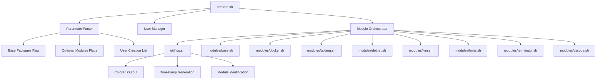

# Design Document: Env Prepare System

## Overview

The Env Prepare system is a modular shell script collection that transforms Ubuntu-based Linux installations into fully configured development environments. The system follows a clean architecture with separation of concerns: a main orchestrator script, a centralized logging utility, and independent installer modules for each component.

The design emphasizes simplicity, maintainability, and robustness through idempotent operations, comprehensive logging, and graceful error handling. Each module can be executed independently or as part of the complete installation process.

## Architecture

### High-Level Architecture



### Directory Structure

```
env-prepare/
├── prepare.sh              # Main orchestrator script
├── util/
│   └── log.sh              # Centralized logging utility
├── modules/
│   ├── base.sh             # Base packages installer
│   ├── docker.sh           # Docker installer
│   ├── golang.sh           # Go language installer
│   ├── dotnet.sh           # .NET installer
│   ├── jvm.sh              # JVM installer (via SDKMAN)
│   ├── fonts.sh            # Font installer
│   ├── terminator.sh       # Terminator installer
│   └── vscode.sh           # VS Code installer
└── README.md               # Documentation
```

## Components and Interfaces

### Main Orchestrator (prepare.sh)

**Responsibilities:**
- Parse command-line parameters
- Validate user inputs
- Create user accounts as requested
- Execute installation modules in proper sequence
- Coordinate logging across all operations

**Interface:**
```bash
./prepare.sh [-u=user1,user2,userN] [-docker] [-golang] [-jvm] [-vscode] [-fonts] [-terminator] [-dotnet]
```

**Key Functions:**
- `parse_parameters()`: Process command-line arguments
- `create_users()`: Create and configure user accounts
- `execute_base_installation()`: Install base packages
- `execute_optional_modules()`: Install selected optional components
- `configure_user_environment()`: Set up per-user configurations

### Logging Utility (util/log.sh)

**Responsibilities:**
- Provide standardized logging functions
- Generate timestamps in ISO format
- Apply color coding for different log levels
- Track module execution times

**Interface:**
```bash
source util/log.sh
log_info "module_name" "message"
log_warn "module_name" "message"
log_debug "module_name" "message"
log_error "module_name" "message"
start_timer "module_name"
end_timer "module_name"
```

**Log Format:**
```
[YYYY-MM-DD HH:MM:SS] [module_name] [LEVEL] message
```

**Color Scheme:**
- INFO: Green
- WARN: Yellow
- DEBUG: Blue
- ERROR: Red

### Installation Modules

Each module follows a consistent interface pattern:

**Standard Module Interface:**
```bash
#!/bin/bash
source ../util/log.sh

MODULE_NAME="module_name"

install_component() {
    start_timer "$MODULE_NAME"
    log_info "$MODULE_NAME" "Installing..."
    
    # Installation logic here
    
    if [ $? -eq 0 ]; then
        end_timer "$MODULE_NAME"
        log_info "$MODULE_NAME" "Successful in $(get_elapsed_time) seconds!"
    else
        log_error "$MODULE_NAME" "Installation failed"
        return 1
    fi
}

configure_for_user() {
    local username=$1
    # User-specific configuration logic
}

# Idempotency check
is_installed() {
    # Check if component is already installed
}

main() {
    if is_installed; then
        log_info "$MODULE_NAME" "Already installed, skipping"
        return 0
    fi
    
    install_component
    
    # Configure for all users
    for user in $(get_all_users); do
        configure_for_user "$user"
    done
}

main "$@"
```

### Base Packages Module (modules/base.sh)

**Responsibilities:**
- Install essential development packages via apt
- Configure shell frameworks (oh-my-zsh, oh-my-bash)
- Set up vim with awesome-vim configuration
- Configure eza aliases for all users

**Package List:**
- System tools: zsh, git, curl, wget, jq, zip, unzip
- Development tools: cmake, build-essential, python3, pip
- Editors: vim, micro
- Monitoring: htop, btop
- Network: telnet, netcat-openbsd, openssh-server
- Security: gpg, ca-certificates, gnupg
- Modern alternatives: batcat, eza
- APIs: httpie, gh

### Optional Modules

#### Docker Module (modules/docker.sh)
- Downloads and executes official Docker installation script
- Adds all users to docker group for non-root access
- Verifies installation with `docker --version`

#### Golang Module (modules/golang.sh)
- Downloads latest stable Go release from official source
- Installs to `/usr/local/go`
- Configures PATH in user profiles
- Verifies with `go version`

#### JVM Module (modules/jvm.sh)
- Installs SDKMAN for Java version management
- Installs latest LTS Java version
- Configures JAVA_HOME and PATH
- Supports multiple Java versions through SDKMAN

#### VS Code Module (modules/vscode.sh)
- Adds Microsoft repository and GPG key
- Installs via apt package manager
- Configures for all users

#### Fonts Module (modules/fonts.sh)
- Clones Powerline Fonts repository
- Clones Nerd Fonts repository
- Executes installation scripts
- Updates font cache

#### Terminator Module (modules/terminator.sh)
- Installs terminator via apt
- Provides basic configuration template

#### .NET Module (modules/dotnet.sh)
- Adds Microsoft package repository
- Installs .NET SDK and runtime
- Configures PATH and environment variables

## Data Models

### User Configuration Structure
```bash
USER_CONFIG = {
    username: string
    home_directory: string
    shell: string (default: /bin/zsh)
    profile_path: string
    created_by_script: boolean
}
```

### Module Status Structure
```bash
MODULE_STATUS = {
    name: string
    installed: boolean
    installation_time: integer (seconds)
    error_message: string (if failed)
    users_configured: array[string]
}
```

### Installation Context
```bash
INSTALLATION_CONTEXT = {
    target_users: array[string]
    selected_modules: array[string]
    base_packages: boolean (always true)
    start_time: timestamp
    log_file: string
}
```

## Correctness Properties

*A property is a characteristic or behavior that should hold true across all valid executions of a system-essentially, a formal statement about what the system should do. Properties serve as the bridge between human-readable specifications and machine-verifiable correctness guarantees.*

Based on the prework analysis and property reflection, the following properties ensure the system behaves correctly across all valid inputs and scenarios:

### Property 1: Base Package Installation Completeness
*For any* execution of the base installation module, all specified base packages (zsh, git, curl, wget, jq, batcat, micro, eza, python3, pip, vim, sqlite3, telnet, htop, btop, gpg, zip, unzip, apt-transport-https, zlib1g, ca-certificates, gnupg, httpie, gh, cmake, build-essential, netcat-openbsd, openssl, openssh-server) should be successfully installed and available on the system.
**Validates: Requirements 1.2**

### Property 2: Conditional Module Installation
*For any* combination of optional module flags (-docker, -golang, -jvm, -vscode, -fonts, -terminator, -dotnet), only the modules corresponding to provided flags should be installed, and all specified modules should be properly configured and functional.
**Validates: Requirements 2.1, 2.2, 2.3, 2.4, 2.5, 2.6, 2.7**

### Property 3: User Environment Consistency
*For any* set of users (existing or created, including root and the invoking user), all users should receive identical development environment configurations including shell aliases, PATH variables, and tool configurations in their .profile files.
**Validates: Requirements 3.2, 3.3, 3.4, 3.5, 3.6**

### Property 4: User Creation from Parameters
*For any* comma-separated list of usernames provided via the -u parameter, each specified user account should be created with zsh as the default shell, proper home directory, and shell configuration.
**Validates: Requirements 3.1**

### Property 5: Sudo Access Configuration
*For any* user created via the -u parameter, that user should be able to execute sudo commands without requiring a password.
**Validates: Requirements 3.7**

### Property 6: Docker Access Configuration
*For any* user created via the -u parameter, that user should be able to execute docker commands without requiring sudo.
**Validates: Requirements 3.8**

### Property 7: Shell Framework Configuration
*For any* user on the system, oh-my-zsh should be configured as the default with agnoster theme, and oh-my-bash should be available as an alternative framework.
**Validates: Requirements 1.4, 1.5, 4.3**

### Property 8: Eza Alias Configuration
*For any* user on the system, the .profile file should contain exactly the specified eza aliases: "ls" mapped to "eza -hHbmgalT -L 1 --time-style=long-iso --icons" and "lt" mapped to "eza -hHbmgalT -L 4 --time-style=long-iso --icons".
**Validates: Requirements 4.1**

### Property 9: Vim Configuration Consistency
*For any* user on the system, vim should be configured with awesome vim settings including line numbers enabled.
**Validates: Requirements 4.2**

### Property 10: Logging Format Compliance
*For any* log entry generated by the system, it should follow the format "[YYYY-MM-DD HH:MM:SS] [module_name] [LEVEL] message" with appropriate color coding for severity levels (INFO=green, WARN=yellow, DEBUG=blue, ERROR=red).
**Validates: Requirements 5.1, 5.2, 5.3**

### Property 11: Module Execution Timing
*For any* module execution, the system should log start time, end time, and total duration, with "Installing..." at start and "Successful in X seconds!" upon completion.
**Validates: Requirements 5.4, 5.5, 5.6**

### Property 12: Installation Idempotency
*For any* number of repeated executions of the same installation command, the system should produce identical results without errors, duplicate installations, or configuration conflicts.
**Validates: Requirements 6.2, 6.4**

### Property 13: Error Handling Continuity
*For any* package installation failure during base package installation, the system should log the error and continue processing remaining packages without terminating the entire installation process.
**Validates: Requirements 1.3**

### Property 14: Common Logging Utility Usage
*For any* script in the system, it should use the centralized logging utility from util/log.sh rather than implementing its own logging mechanism.
**Validates: Requirements 6.3**

## Error Handling

The system implements comprehensive error handling at multiple levels:

### Script-Level Error Handling
- Each script uses `set -euo pipefail` for strict error checking
- Exit status codes are checked for all critical operations
- Failed operations are logged with ERROR level before graceful degradation

### Module-Level Error Handling
- Package installation failures are isolated to prevent cascade failures
- Each module implements retry logic for network-dependent operations
- Modules validate prerequisites before attempting installation

### User-Level Error Handling
- User creation failures are logged but don't prevent environment setup for existing users
- Permission errors during user configuration are handled gracefully
- Invalid usernames in the -u parameter are filtered out with warnings

### Logging Error Handling
- Log directory creation is verified before logging begins
- Fallback to stdout if log file cannot be created
- Timestamp generation failures default to simple date format

## Testing Strategy

The testing approach combines unit testing for specific functionality with property-based testing for universal correctness guarantees.

### Unit Testing Approach
- **Specific Examples**: Test concrete scenarios like installing Docker with specific users
- **Edge Cases**: Test empty user lists, invalid parameters, network failures
- **Integration Points**: Test interaction between main script and modules
- **Error Conditions**: Test behavior when packages are unavailable or permissions are insufficient

### Property-Based Testing Approach
- **Universal Properties**: Test properties that must hold for all valid inputs
- **Randomized Testing**: Generate random combinations of parameters and user lists
- **Idempotency Verification**: Run installations multiple times with random intervals
- **Configuration Consistency**: Verify identical configurations across randomly generated user sets

### Testing Framework Configuration
- Use **Bash Unit Testing Framework (bats)** for unit tests
- Use **property-based testing with random input generation** for property tests
- Configure property tests to run minimum 100 iterations per property
- Each property test references its design document property with format: **Feature: env-prepare, Property {number}: {property_text}**

### Test Organization
```
tests/
├── unit/
│   ├── test_parameter_parsing.bats
│   ├── test_user_creation.bats
│   ├── test_module_installation.bats
│   └── test_logging.bats
├── property/
│   ├── test_installation_properties.bats
│   ├── test_user_configuration_properties.bats
│   └── test_idempotency_properties.bats
└── integration/
    ├── test_full_installation.bats
    └── test_multi_user_scenarios.bats
```

The dual testing approach ensures both specific functionality works correctly (unit tests) and universal properties hold across all possible inputs (property tests), providing comprehensive coverage for this critical system administration tool.
